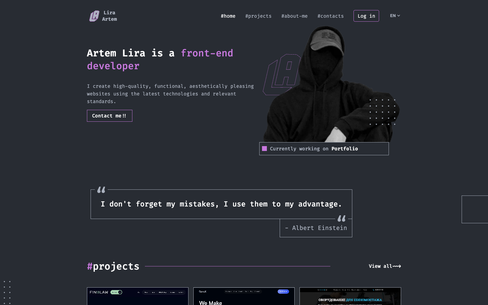
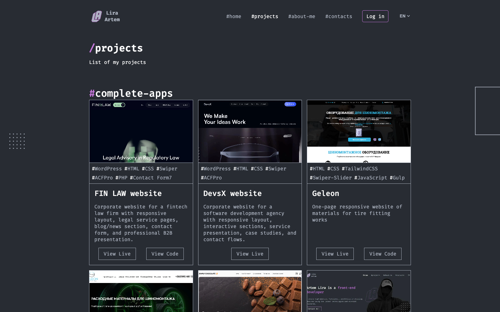
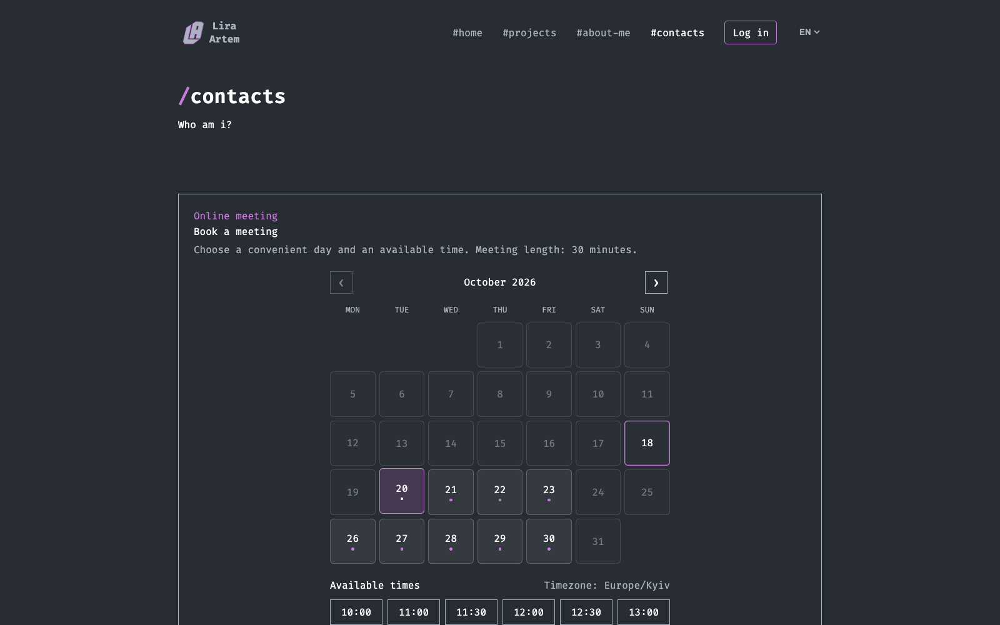
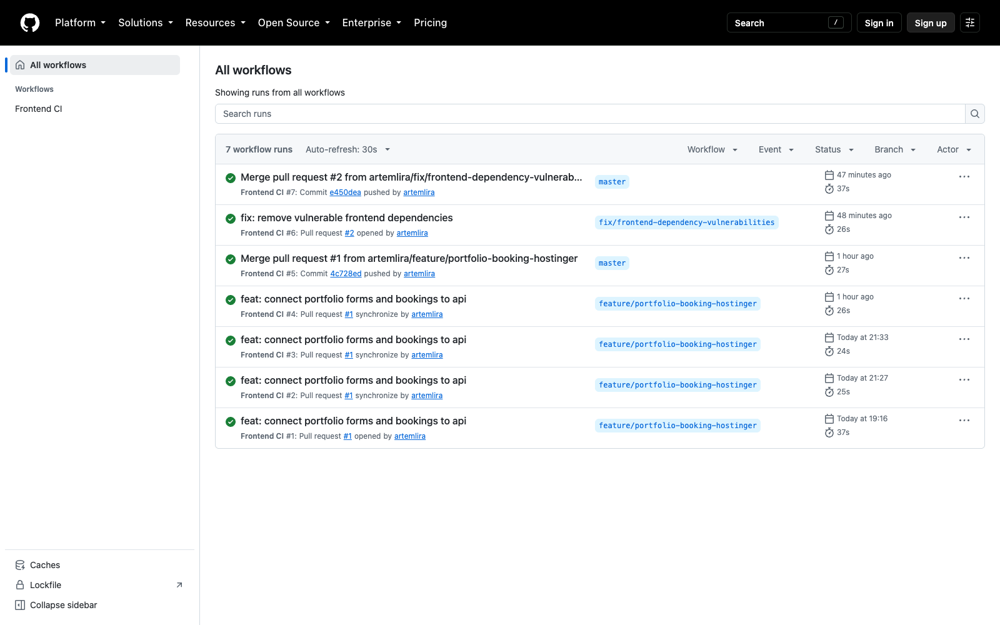
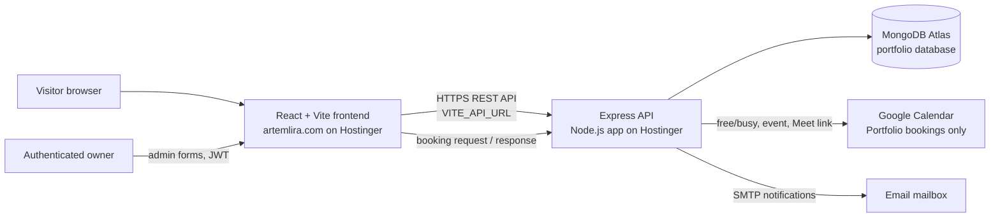

# Artem Lira — Developer Portfolio

A bilingual, data-driven portfolio for presenting development work, professional background, and contact options. The site is more than a static showcase: its protected admin interface lets the portfolio owner maintain the content directly in the website, while a separate Node.js API handles data, authentication, bookings, email, and Google Calendar integration.

| | |
| --- | --- |
| Live portfolio | [artemlira.com](https://artemlira.com) |
| Frontend repository | [artemlira/React-Portfolio_multipage](https://github.com/artemlira/React-Portfolio_multipage) |
| Backend repository | [artemlira/MERN_Portfolio-back](https://github.com/artemlira/MERN_Portfolio-back) |
| Backend API | The Node.js application deployed on Hostinger; set its public origin in `VITE_API_URL` for each production build. |

## Product overview

The public experience includes Home, Projects, About, and Contacts pages, with English and Ukrainian content, responsive layouts, project galleries, contact details, and a meeting-booking flow. Most portfolio content is read from the API and MongoDB rather than being hard-coded in page components.

An authenticated owner can sign in and create, edit, and remove portfolio content from the website itself. This is a small, purpose-built content-management interface: changes go through the React forms to authenticated API endpoints and are stored in MongoDB. It does not require editing source files or manually deploying for each content update.

## Screenshots

Screenshots captured from the live portfolio and GitHub Actions on October 18, 2026.

<p align="center"></p>
<p align="center"><em>Home page and featured work.</em></p>

<p align="center"></p>
<p align="center"><em>Data-driven project listing with descriptions, technology tags, and live/code links.</em></p>

<p align="center"></p>
<p align="center"><em>Booking interface showing available days, time slots, and timezone.</em></p>

<p align="center"></p>
<p align="center"><em>Entry point for the protected owner/admin area.</em></p>

<p align="center"></p>
<p align="center"><em>Frontend CI workflow runs, including pull-request checks and a push to the repository's <code>master</code> branch.</em></p>

## How the two repositories work together



The frontend is responsible for navigation, presentation, localization, form state, and calling the API. The backend is the trust boundary: it validates requests, checks JWTs for administrative changes, reads/writes MongoDB, and communicates with SMTP and the configured Google Calendar. Secrets and service-account credentials belong in Hostinger environment variables, never in frontend code or Git.

## Frontend features

- **Portfolio pages:** Home, Projects, About, and Contacts, assembled from reusable page sections and shared layout components.
- **Two languages:** English and Ukrainian translations loaded from `public/locales`; the selected language is remembered by the browser.
- **Dynamic content:** projects, smaller projects, skills, facts, contacts, and social-media links are fetched from the backend.
- **Custom admin interface:** protected forms for adding and editing those content types, with API validation feedback and delete actions where supported.
- **Authentication-aware UI:** login and registration forms, JWT-backed auth state, protected edit routes, and an admin bookings view.
- **Interactive booking calendar:** retrieves the configured timezone, dates and available slots from the API; submits the visitor's name, email, note, chosen time, and current site language.
- **Booking response page:** lets an invitee confirm or decline attendance through the secure link in the email.
- **Responsive motion and media:** SCSS Modules, Swiper project carousels, Framer Motion and GSAP animations, image/icon assets, and Material UI components/icons.
- **Accessibility and feedback:** labelled forms, loading/success/error states, and responsive controls for desktop and mobile layouts.

## Booking experience, end to end

1. The visitor opens the booking form on Home or Contacts. The calendar requests booking settings and availability from the backend; available times account for the configured weekly schedule, minimum notice, booking window, existing bookings, and Google Calendar busy periods.
2. The visitor selects a slot and submits their name, email, optional note, and the active site language. The API validates the request and checks availability again immediately before creating the booking, so a slot that became unavailable is rejected.
3. The backend stores the booking in MongoDB and creates a generic `Portfolio meeting` event in the dedicated Google Calendar. Google Calendar generates a unique Google Meet conference; the API waits for the Meet URL before treating the calendar sync as successful. A unique database constraint also prevents two bookings from taking the same start time.
4. When SMTP is configured, the owner receives a booking notification and the visitor receives a confirmation email in the language selected on the site. The visitor email includes the localized date and time, the Google Meet URL, and a secure link to confirm or decline attendance.
5. The response link contains a random, single-use token. Only its hash is stored in MongoDB. The response page submits the token to the API; the response is saved as confirmed or declined and the link expires when the meeting starts. The protected admin bookings page shows the response and Meet link.
6. When the owner cancels a booking from the admin page, the API removes its Google Calendar event and the MongoDB booking. If Calendar sync fails while creating a booking, the API cleans up the partial booking/event and returns an error rather than confirming an incomplete meeting. If only email delivery fails after a successful booking, the booking remains saved and the interface reports the notification problem.

The calendar event deliberately contains a generic title and description; the visitor's name, email, and note are not copied into Google Calendar. The integration checks free/busy and creates/deletes events on the calendar shared with the service account. No personal calendar needs to be shared with the application.

## Content managed from the website

The admin UI provides a practical CMS-style workflow for portfolio updates:

| Content | Public API collection | Admin workflow |
| --- | --- | --- |
| Full projects / case studies | `projects` | Create, edit, delete; display in project sections and project listings. |
| Smaller projects | `smallprojects` | Create, edit, delete; show compact project cards. |
| Skills | `skills` | Add, edit, delete; update the About/skills section. |
| Professional facts | `facts` | Add and remove short background facts. |
| Contact methods | `contacts` | Add, edit, delete; update public contact details. |
| Social/media links | `media` | Add, edit, delete; update social links and contact media. |
| Bookings | `bookings` | View scheduled meetings, attendee responses, and Meet links; cancel meetings. |

The UI uses one form flow per content type and the backend remains the source of truth. Bookings are operational records, not portfolio copy.

## Technology

| Area | Technologies |
| --- | --- |
| UI | React 19, JavaScript, JSX |
| Build and local development | Vite 7, Node.js 22, npm |
| Routing | React Router |
| State and API data | Redux Toolkit, React Redux, Axios |
| Forms | React Hook Form |
| Localization | i18next, react-i18next, i18next HTTP backend, browser language detector |
| Styling | Sass/SCSS Modules, PostCSS, Autoprefixer |
| Interaction | Swiper, Framer Motion, GSAP, Material UI / Emotion |
| Quality | ESLint (Airbnb configuration), Prettier, GitHub Actions |
| Production | Static Vite build hosted on Hostinger; Express API is a separate Hostinger Node.js app |

## Repository structure

```text
src/
  assets/                  Images, illustrations, and SVG icons
  components/              Shared layout, page sections, admin forms, booking UI
  components/Page_*/       Sections for Home, Projects, About, and Contacts
  hooks/                   Shared React hooks, including contact submission
  pages/                   Home, Projects, About, Contacts, booking/admin pages
  redux/
    slices/                Auth and portfolio-resource state/API actions
  styles/                  Global SCSS, tokens, mixins, and shared functions
  utils/                   Axios API client and data helpers
public/
  locales/en/              English translation catalog
  locales/ua/              Ukrainian translation catalog
  assets/                  Public static assets
.github/workflows/ci.yml   Frontend CI checks
```

The backend's matching structure, API contract, and data models are documented in its [README](https://github.com/artemlira/MERN_Portfolio-back#readme).

## Local development

```bash
npm ci
cp .env.example .env.local
npm run dev
```

Set the API origin in `.env.local` before using backend features:

```env
VITE_API_URL=http://localhost:4444
VITE_BOOKING_TIMEZONE=Europe/Kyiv
```

Run the API separately using the instructions in the backend repository. The frontend does not connect directly to MongoDB and must never contain database credentials, SMTP passwords, JWT secrets, or Google service-account JSON.

Useful commands:

```bash
npm run lint
npm run build
npm run preview
```

## Configuration and deployment

The frontend is a static Vite application. Build it with `npm run build`; the deployable files are written to `dist/`. On Hostinger, connect this repository to the static website hosting for `artemlira.com`, use Node.js 22 for the build environment, run `npm ci` and `npm run build`, and publish `dist/`. Configure `VITE_API_URL` to the public origin of the Hostinger Node.js backend before building. Because Vite embeds `VITE_*` values into the generated client bundle, this variable must contain a public API URL only, never a secret.

The repository's GitHub Actions workflow is **CI**, not the Hostinger deployment mechanism. For pull requests targeting `master` and pushes to `master`, it checks out the code, installs dependencies with `npm ci`, runs ESLint, and builds the production frontend. The release flow is: open a PR → wait for CI → merge into the deployment branch → let the Hostinger Git/deployment integration publish the static build. Hostinger must be configured to watch the intended branch and build/publish commands; a green GitHub Actions run alone does not upload the site.

`netlify.toml` and `public/_redirects` are legacy deployment compatibility files. The production target described here is Hostinger; do not use the legacy Netlify API URL as the production `VITE_API_URL`.

## Security notes

- Administrative API calls attach the JWT from browser storage; frontend route protection is for navigation and user experience, while the backend independently protects write endpoints.
- The API currently has a registration endpoint and does not expose role-based authorization. Before opening registration to the public, restrict account creation or add an explicit administrator/role policy so a newly registered account cannot obtain content-management access.
- Do not commit `.env.local`, database URIs, mail credentials, Google Calendar service-account keys, or production tokens.
- Project images may be stored as base64 data through the API/MongoDB. A dedicated object-storage service could be a future improvement for larger media libraries.
